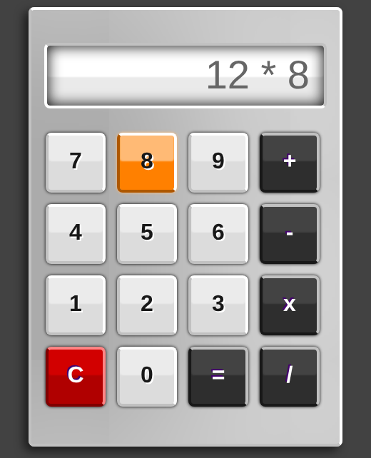
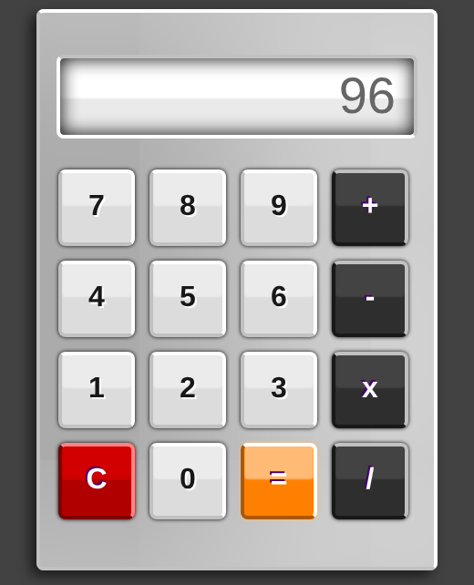

# Calculator

A browser calculator built with plain HTML, CSS and inline JavaScript, with no build step and no dependencies.

## Screenshots

| Entering `12 × 8` | Result |
|:---:|:---:|
|  |  |

## Features

- Digits 0–9 and the four basic operations (+, −, ×, ÷)
- `C` clears the display, `=` evaluates the expression
- Skeuomorphic button styling with hover and press effects
- Custom 404 page (`error.html`)

## Files

| File | Purpose |
|---|---|
| `index.html` | Calculator UI and logic (readonly display plus digit/operator buttons). |
| `error.html` | Custom 404 page. |

## Run

Open `index.html` in any browser, or serve the folder:

```bash
python3 -m http.server 8000   # then visit http://localhost:8000
```

## Author

Sanket Mali · [GitHub](https://github.com/Sanket1516)
